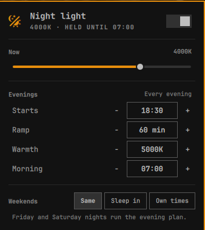

# Sebset

A gentle, scheduled night light for the [Omarchy](https://omarchy.org) bar. In the evening the
screen warms slowly, in steps too small to notice, and in the morning it goes back to neutral.
Weekends get a later, milder plan of their own, and a vacation switch uses that plan every day.
It is like f.lux, inside the Omarchy shell, driving the `hyprsunset` that Omarchy already ships.

 <!-- screenshot placeholder -->

## Install

```bash
omarchy plugin add <git-url> --enable
```

The icon lands in the bar next to the clock (`centerBegin`). Move it with
`omarchy bar move sebset.nightlight --section <section>`.

Omarchy's own night-light indicator does the same job, so you may want to hide it. In
`~/.config/omarchy/shell.json`, give the `omarchy.indicators` entry the indicators you want to keep:

```json
{ "id": "omarchy.indicators", "items": ["PasswordlessSudo", "ScreenRecording", "RemoteSession", "Reminder", "Dnd", "StayAwake"] }
```

### Manual install

Clone the repo anywhere and link it into the shell's plugin folder:

```bash
git clone <git-url> ~/src/sebset
ln -s ~/src/sebset ~/.config/omarchy/plugins/sebset
omarchy-shell shell rescanPlugins
```

The shell reads a linked plugin's files once per path, so after editing the code, run
`omarchy restart shell` to see the change.

## Use

| On the bar icon | Does |
|---|---|
| Left click | Toggles warm and neutral. From neutral it turns on the evening's end warmth. |
| Scroll | Up is warmer, down is cooler, 250K a notch, from 3000K to 6500K. |
| Right click | Opens the menu. |

The icon takes the theme's accent colour while the screen is warm. Its tooltip says what is
happening: `5400K · warming until 19:30`, `Neutral · dusk starts 18:30`.

A click, a scroll or the slider holds the new temperature until the next turn of the schedule:
the next evening's start, or the next morning. Then the schedule takes over again.

The menu has:

- **Now**: a warmth slider. Right is warmer. It applies at once.
- **Weekdays** (Sunday to Thursday evenings) and **Weekend** (Friday and Saturday evenings, the
  nights before a day off), each with a start time, a ramp length, an end warmth and a morning
  time. The − and + buttons step 15 minutes, 5 minutes of ramp or 100K. Click a value to type an
  exact one (`18:43`, `37`, `5150`), or scroll over it for 1-minute and 10K steps.
- **Vacation**: the weekend plan every evening.
- The switch at the top turns the schedule off. The screen goes neutral, and the icon, scroll and
  slider still work, holding what you set until you change it.

In the menu, Left and Right also move the warmth, `s` toggles the schedule, `v` toggles vacation and
Esc closes it.

### Keybindings

The shell answers these, so they bind like any Omarchy command:

```bash
omarchy-shell sebset toggle                    # open or close the menu
omarchy-shell sebset.nightlight toggleWarm     # what a left click does
omarchy-shell sebset.nightlight warmer         # one scroll notch up
omarchy-shell sebset.nightlight cooler         # one scroll notch down
omarchy-shell sebset.nightlight resume         # drop a manual change, follow the schedule
omarchy-shell sebset.nightlight toggleSchedule
omarchy-shell sebset.nightlight toggleVacation
omarchy-shell sebset.nightlight status         # JSON: kelvin, phase, manual hold
```

For example, in `~/.config/hypr/bindings.conf`:

```
bindd = SUPER CTRL, N, Night light, exec, omarchy-shell sebset.nightlight toggleWarm
```

## The schedule

The defaults:

| | Weekdays | Weekend |
|---|---|---|
| Starts | 18:30 | 20:00 |
| Ramp | 60 min | 60 min |
| End warmth | 5000K | 5500K |
| Morning | 07:00 | 09:00 |

Daytime is always neutral. From the start time, the screen moves from 6500K to the end warmth
over the ramp, holds that through the night, and turns neutral at the morning time at once.
A ramp of 0 minutes switches straight to the end warmth.

- An evening belongs to the day it starts on, so Friday's plan runs into Saturday morning.
- Start times run from 12:00 to 05:59: a start of 00:30 is half past midnight that night.
  Morning times run up to 12:00.
- A morning that comes before the ramp ends cuts the ramp short.
- Times are wall-clock times, so on the nights the clocks change, the ramp still starts at the
  clock's 18:30 and the morning still comes at the clock's 07:00.

## Settings file

`~/.config/sebset/settings.json` (or `$XDG_CONFIG_HOME/sebset/settings.json`), written when you
change something in the menu:

```json
{
  "scheduleEnabled": true,
  "vacation": false,
  "weekdays": { "start": "18:30", "rampMinutes": 60, "endKelvin": 5000, "morning": "07:00" },
  "weekend": { "start": "20:00", "rampMinutes": 60, "endKelvin": 5500, "morning": "09:00" }
}
```

You can edit it by hand; the plugin picks the change up. A missing field takes its default, and a
value out of range is clamped (ramps 0 to 240 minutes, warmth 3000K to 6500K). A file that does
not parse means the defaults, without touching the file.

## How it treats hyprsunset

Sebset sets the screen with `hyprctl hyprsunset temperature <K>`, and neutral with
`hyprctl hyprsunset identity`, since even 6500K tints the screen a little. When `hyprsunset` is
not running it starts it the way Omarchy's own night light does. It never edits
`~/.config/hypr/hyprsunset.conf`.

It does not watch `hyprsunset`. If something else changes the temperature (Omarchy's own toggle,
a profile in `hyprsunset.conf`), Sebset puts its value back at its next step or turn of the
schedule.

## Running cost

Sebset runs inside the Omarchy shell that is already running: no daemon, no polling. One
single-shot timer wakes it for the next change the schedule knows about: the evening's start, each
step of a ramp, the morning. While it waits, the timer also wakes every 15 minutes at most, which
only recomputes in JavaScript and catches a suspend or a clock change. A process (`hyprctl`) runs
only when the temperature actually changes.

A ramp steps at most 25K at a time, as rarely as that allows: 1500K over an hour is one step a
minute, 1500K over 10 minutes one every 10 seconds. Steps never come faster than every 5 seconds,
so a very steep ramp (more than 300K a minute) takes bigger steps.

## Uninstall

```bash
omarchy plugin remove sebset.nightlight
hyprctl hyprsunset identity      # back to neutral
rm -r ~/.config/sebset           # the settings, if you want them gone
```

Give `omarchy.indicators` its night-light indicator back by removing the `items` list, if you added one.

## Develop

`Schedule.js` holds the schedule as pure functions; the QML only shows and applies it.

```bash
node --test tests/
/usr/lib/qt6/bin/qmllint Panel.qml Service.qml Stepper.qml
```

## License

MIT. See [LICENSE](LICENSE).
