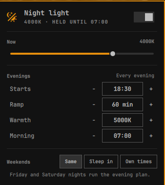

# Sebset in detail

A gentle, scheduled night light for the [Omarchy](https://omarchy.org) bar. In the evening the
screen warms slowly, in steps too small to notice, and in the morning it goes back to neutral.
Weekends can sleep in, or get a plan of their own, and a vacation switch makes every night a
weekend night.
It is like f.lux, inside the Omarchy shell, driving the `hyprsunset` that Omarchy already ships.



## Install

```bash
omarchy plugin add https://github.com/ikkeseb/sebset.git --enable
```

The icon lands in the bar next to the clock (`centerBegin`). Move it with
`omarchy bar move sebset.nightlight --section <section>`.

Omarchy's own night-light indicator does the same job, so you may want to hide it. In
`~/.config/omarchy/shell.json`, give the `omarchy.indicators` entry the indicators you want to keep:

```json
{ "id": "omarchy.indicators", "items": ["PasswordlessSudo", "ScreenRecording", "RemoteSession", "Reminder", "Dnd", "StayAwake"] }
```

### Manual install

Clone the repo anywhere and link it into the shell's plugin folder:

```bash
git clone https://github.com/ikkeseb/sebset.git ~/src/sebset
ln -s ~/src/sebset ~/.config/omarchy/plugins/sebset
omarchy-shell shell rescanPlugins
omarchy plugin enable sebset.nightlight
```

The shell reads a linked plugin's files once per path, so after editing the code, run
`omarchy restart shell` to see the change.

## Use

| On the bar icon | Does |
|---|---|
| Left click | Toggles warm and neutral. From neutral it turns on the evening's end warmth. |
| Scroll | Up is cooler (more kelvin), down is warmer, 250K a notch, from 3000K to 6500K. |
| Right click | Opens the menu. |

While the pointer rests on the icon, its tooltip follows every click and wheel notch live. The
screen moves in 100K bands (see [How it treats hyprsunset](#how-it-treats-hyprsunset)), so a notch
of 250K shows and applies the nearest band: from 5000K, one notch cooler is `5300K`, two are `5500K`.

The icon takes the theme's accent colour while the screen is warm. Its tooltip says what is
happening: `5400K · warming until 19:30`, `Neutral · dusk starts 18:30`.

A click, a scroll or the slider holds the new temperature until the next turn of the schedule:
the next evening's start, or the next morning. Then the schedule takes over again.

The menu has:

- **Now**: a warmth slider. Right is warmer. It applies at once.
- **Evenings**: the plan: a start time, a ramp length, an end warmth and a morning time. The − and
  + buttons step 15 minutes, 5 minutes of ramp or 100K. Click a value to type an exact one
  (`18:43`, `37`, `5200`), or scroll over it for 1-minute and 100K steps. A typed value out of
  range is clamped, and the field shows what it became.
- **Weekends**, for Friday and Saturday nights, the nights before a day off:
  - **Same** (the default): they run the evening plan like every other night.
  - **Sleep in**: the evening plan, with a later **Weekend morning** (09:00 by default).
  - **Own times**: a plan of their own, with the same four fields.
- **Vacation** (shown unless weekends are the same): every night is a weekend night, sleeping in
  or on the weekend plan.
- The switch at the top turns the schedule off. The screen goes neutral, and the icon, scroll and
  slider still work, holding what you set until you change it.

Any change in the menu ends a held click, scroll or slider value: the schedule takes over from the
new settings at once.

In the menu, Left and Right also move the warmth, `s` toggles the schedule, `v` toggles vacation and
Esc closes it.

### Keybindings

The shell answers these, so they bind like any Omarchy command:

```bash
omarchy-shell sebset toggle                    # open or close the menu
omarchy-shell sebset.nightlight toggleWarm     # what a left click does
omarchy-shell sebset.nightlight warmer         # one scroll notch up
omarchy-shell sebset.nightlight cooler         # one scroll notch down
omarchy-shell sebset.nightlight resume         # drop a manual change, follow the schedule
omarchy-shell sebset.nightlight toggleSchedule
omarchy-shell sebset.nightlight toggleVacation
omarchy-shell sebset.nightlight status         # JSON: kelvin, phase, manual hold
```

`toggleWarm`, `warmer` and `cooler` show Omarchy's on-screen display with the new value (`5300K`
or `Neutral`) and a bar that fills as the screen warms, since a keybinding has no tooltip.

For example, in `~/.config/hypr/bindings.lua`:

```lua
o.bind("SUPER + CTRL + N", "Night light", "omarchy-shell sebset.nightlight toggleWarm")
```

## The schedule

The defaults:

| | Evenings | Weekend (own times) |
|---|---|---|
| Starts | 18:30 | 20:00 |
| Ramp | 60 min | 60 min |
| End warmth | 5000K | 5500K |
| Morning | 07:00 | 09:00 |

Weekends start as **Same**; **Sleep in** keeps the evening plan with a 09:00 morning.

Daytime is always neutral. From the start time, the screen moves from 6500K to the end warmth
over the ramp, holds that through the night, and turns neutral at the morning time at once.
A ramp of 0 minutes switches straight to the end warmth.

- An evening belongs to the day it starts on, so Friday's plan runs into Saturday morning.
- Start times run from 12:00 to 05:59: a start of 00:30 is half past midnight that night.
  Morning times run from 00:00 to 14:00, so a vacation can sleep in.
- A morning that comes before the ramp ends cuts the ramp short. A morning later than the next
  evening's start (a 14:00 morning after a 12:30 start) ends at that start.
- Times are wall-clock times, so on the nights the clocks change, the ramp still starts at the
  clock's 18:30 and the morning still comes at the clock's 07:00.

## Settings file

`~/.config/sebset/settings.json` (or `$XDG_CONFIG_HOME/sebset/settings.json`), written when you
change something in the menu:

```json
{
  "scheduleEnabled": true,
  "weekendMode": "same",
  "weekendMorning": "09:00",
  "vacation": false,
  "evenings": { "start": "18:30", "rampMinutes": 60, "endKelvin": 5000, "morning": "07:00" },
  "weekend": { "start": "20:00", "rampMinutes": 60, "endKelvin": 5500, "morning": "09:00" }
}
```

`weekendMode` is `same`, `sleepIn` or `own`; `weekendMorning` is the sleep-in morning and `weekend`
the own-times plan. Both are kept while another mode is on.

You can edit the file by hand, or create it: the plugin makes `~/.config/sebset/` when it starts
and picks the file up when it appears or changes. A change ends a held click, scroll or slider value.
A missing field takes its default (a missing or unknown `weekendMode` is `same`), and a value out of
range is clamped (ramps 0 to 240 minutes, warmth 3000K to 6500K on 100K steps, mornings up to
14:00). A file that does not parse means the defaults, without touching the file.

## How it treats hyprsunset

Sebset sets the screen with `hyprctl hyprsunset temperature <K>`, and neutral with
`hyprctl hyprsunset identity`, since even 6500K tints the screen a little. When `hyprsunset` is
not running it starts it the way Omarchy's own night light does and waits up to 5 seconds for it
to answer. A failed call is tried once more after 5 seconds. It never edits
`~/.config/hypr/hyprsunset.conf`.

hyprsunset (0.4) computes its colour matrix from the temperature in whole hundreds, so 6450K
looks exactly like 6400K. Sebset therefore only ever sends multiples of 100K and steps a ramp one
100K band at a time.

It does not watch `hyprsunset`. Something else can change the temperature: a profile in
`hyprsunset.conf` (Omarchy ships a 07:00 one), a restart of `hyprsunset`, or Omarchy's own
night-light toggle in its menu. So at every 15-minute re-check Sebset sets its current value
again, even when it believes it is already on screen. Omarchy's stock toggle therefore lasts until
the next re-check at most; use Sebset's icon or its `toggleWarm` command instead.

## Tip: smooth steps

Hyprland fades between colour matrices by default on AMD and Intel GPUs (`render:ctm_animation`
on `auto`), so every temperature change re-renders the screen for a moment and can show as a short
frame hitch. Sebset already ramps in small steps, so you may prefer to turn the fade off (it is a compositor-wide setting).

In `~/.config/hypr/looknfeel.lua` (Lua config):

```lua
hl.config({ render = { ctm_animation = 0 } })
```

Or in a hyprlang config (`hyprland.conf`):

```
render {
    ctm_animation = 0
}
```

## Running cost

Sebset runs inside the Omarchy shell that is already running: no daemon, no polling. One
single-shot timer wakes it for the next change the schedule knows about: the evening's start, each
step of a ramp, the morning. While it waits, the timer also wakes every 15 minutes at most, which
catches a suspend or a clock change and re-asserts the temperature with one tiny `hyprctl` call:
about 96 a day, day and night. Otherwise a process runs only when the screen's 100K band actually
changes, and for the on-screen display after a keybinding command (one `omarchy-shell` call;
Omarchy lets only its own plugins show the OSD in-process).

A ramp takes one 100K band per step, spread evenly over its length: 6500K to 5000K over an hour is
15 steps, one every 4 minutes. Steps never come sooner than 5 seconds apart, so a ramp steeper
than 100K per 5 seconds ends later than its length says: a 1-minute ramp to 3000K takes 35 steps
of 5 seconds, almost 3 minutes.

## Uninstall

```bash
omarchy plugin remove sebset.nightlight
hyprctl hyprsunset identity      # back to neutral
rm -r ~/.config/sebset           # the settings, if you want them gone
```

Give `omarchy.indicators` its night-light indicator back by removing the `items` list, if you added one.

## Develop

`Schedule.js` holds the schedule as pure functions; the QML only shows and applies it.

```bash
node --test tests/
/usr/lib/qt6/bin/qmllint Panel.qml Service.qml Stepper.qml
```

## License

MIT. See [LICENSE](../LICENSE).
